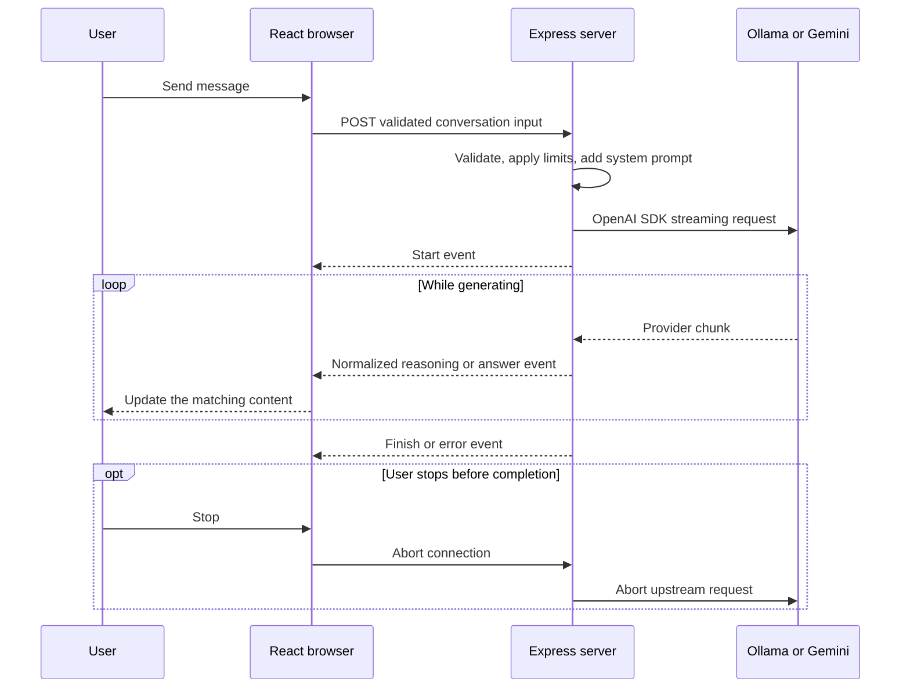

# A staged learning project for streaming AI chat

Status: approved design, saved for implementation. Application development has not started.

This file includes the approved project plan and the later requirement to document development issues and solutions. It is the implementation source of truth for a new Codex session. Read [AGENTS.md](AGENTS.md) first.

## Start here in a fresh session

Use this instruction when you want implementation to begin:

> Read AGENTS.md and IMPLEMENTATION_PLAN.md. Implement the complete v1 through stages 1–8 in order, with runnable checkpoints, tests, stage documentation, and the issues-and-solutions journal. Continue through the stages without asking me to approve routine implementation choices. Use Ollama for development and keep Gemini tests explicit. Keep the handoff current and report any verification that could not be completed.

Inspect the actual repository and runtime before starting. After development begins, also read `docs/handoff.md` and the current stage document. Resume unfinished work instead of recreating completed stages. This saved plan does not itself start development.

## 1. Goal and agreed scope

Build a complete, readable text chatbot that demonstrates sound production practices for request handling, streaming, cancellation, errors, and rendering.

The codebase should answer both "How does this work?" and "Why is it structured this way?" The user will study the generated implementation and documentation. Beginner readability and development chronology are core requirements, not optional polish.

Decisions already agreed:

- React and TypeScript frontend, Express and TypeScript backend.
- Personal use on the user's computer.
- One conversation in memory. Refreshing clears it.
- Local `qwen3.5:4b` through Ollama for everyday development.
- Gemini for explicitly selected cloud runs.
- OpenAI SDK on the backend for both providers.
- No automatic provider fallback.

V1 includes multi-turn text chat, optional reasoning display, streaming Markdown, Stop, Retry, New chat, context limits, useful errors, automated tests, and learning documentation.

Saved conversations, authentication, tools, retrieval, images, audio, and public deployment become later stages. Do not add them to v1.

## 2. Architecture and provider decisions

Use one npm project with clear boundaries:

```text
src/
  client/       React interface, chat state, stream consumption
  server/       HTTP routes, validation, prompts, provider adapters
  shared/       Request schemas and application stream-event types
tests/          Integration tests, browser tests, provider fixtures
docs/           Architecture decisions, learning path, numbered stages
```

| Choice | Reason |
|---|---|
| React + Vite and Express | Makes the browser/server boundary visible and easy to study. |
| TypeScript + Zod | Types explain contracts; runtime validation checks incoming data. |
| Native `fetch` and React state/reducer | Keeps networking and state management visible without another framework. |
| OpenAI SDK with small provider adapters | Shares the main workflow while containing provider differences. |
| Chat Completions | Provides a common streaming interface for Ollama and Gemini. |
| Server-Sent Events over a POST response | Supports a JSON request followed by incremental server output. |
| Plain CSS and focused components | Keeps the interface understandable without a large component framework. |

Both providers document OpenAI-compatible Chat Completions streaming. Compatibility covers selected features, so adapters normalize responses rather than assuming identical APIs. See [Ollama compatibility](https://docs.ollama.com/api/openai-compatibility) and [Gemini compatibility](https://ai.google.dev/gemini-api/docs/openai).

Development uses Vite's proxy for `/api`. The production build runs through one Express process serving both the frontend and API. Both bind to loopback by default.

Keep modules focused and use readable TypeScript. Avoid orchestration frameworks, elaborate generic abstractions, microservices, or a separate state-management library. Explain non-obvious boundaries and error handling.

### Provider configuration

Server-only environment configuration:

- Ollama URL defaults to `http://127.0.0.1:11434/v1`.
- Ollama model defaults to the installed `qwen3.5:4b`.
- Gemini uses Google's OpenAI-compatible endpoint, `https://generativelanguage.googleapis.com/v1beta/openai/`.
- Gemini model defaults to `gemini-2.5-flash`, configurable through `.env`. At planning time, it had a documented free tier. Account availability and quotas require verification with the user's key. See [Gemini pricing](https://ai.google.dev/gemini-api/docs/pricing) and [deprecations](https://ai.google.dev/gemini-api/docs/deprecations).
- Gemini is unavailable in the UI until its key is configured.
- Credentials and provider URLs never come from chat requests.
- Keep real secrets in an ignored local `.env`; provide a documented `.env.example` containing placeholders only. Never expose secrets through frontend environment variables or logs.

The interface selects Local or Gemini before the first message. The provider stays fixed for that conversation. New chat clears the conversation and returns to Local, preventing accidental transfer of local conversation history to Gemini.

Preserve the user's Ollama GPU, thread, sampling, and context tuning. Add a local thinking toggle, off by default for faster testing. Turning it on demonstrates reasoning streaming.

For Gemini, v1 streams the answer without explicitly requesting thought summaries. Only separately identified reasoning fields may enter the reasoning panel; ordinary answer text is never split using guessed markers. Do not describe private or unavailable reasoning as visible content. A provider's thought summary is not necessarily a full reasoning trace.

### Verified planning observations

These are observations from September 13, 2026, not a substitute for fresh checks during implementation:

- The repository initially contained no application code and had no Git commits.
- Node was `v24.18.1`; npm was `12.0.2`.
- Ollama was available at `/home/user228/.local/bin/ollama` and its local HTTP server responded.
- The selected model was `qwen3.5:4b`, with completion and thinking capabilities.
- Its tuned parameters were `num_ctx=4096`, `num_gpu=34`, `num_thread=4`, `temperature=1`, `top_p=0.95`, `top_k=20`, and `presence_penalty=1.5`.
- A short OpenAI-compatible streaming probe with a deliberately small 96-token output cap emitted `choices[0].delta.reasoning`, no answer text, and `finish_reason: "length"`. The final usage reported 21 prompt tokens and 96 completion tokens. This proves the incomplete reasoning-only case matters; it does not mean the model is broken.
- An answer-only probe with `reasoning_effort: "none"` and a 32-token cap returned `4` for `What is 2 + 2?`, with `finish_reason: "stop"`.
- No Gemini generation requests were made during planning. No Gemini credential was inspected or verified.

## 3. Request flow, streaming contract, and user experience



The Stop branch applies at any point while the request is active. Document the cancellation path separately in the implementation architecture diagram if that makes its timing clearer.

### Application interfaces

Provide three endpoints:

- `GET /api/health`: confirms the application server is running.
- `GET /api/config`: exposes provider names, configured availability, and public limits. It makes no generation requests. Configuration availability must not be presented as a successful live connectivity test.
- `POST /api/chat`: accepts a request ID, provider choice, conversation messages, and the local thinking preference.

The browser sends completed user/assistant exchanges plus the new user message. The server owns the system prompt, initially a concise, beginner-friendly JavaScript tutor instruction.

The application stream has five typed events:

| Event | Purpose |
|---|---|
| `start` | Identifies the request, provider, and model. |
| `reasoning_delta` | Appends separately supplied reasoning text. |
| `answer_delta` | Appends answer text. |
| `finish` | Reports completion or an incomplete/blocked result, with available usage. |
| `error` | Reports an actionable failure without exposing credentials or upstream internals. |

Each event includes the request ID. Late events from an aborted or replaced request cannot update another response. Document the exact implemented schemas in the protocol guide and keep shared types aligned with runtime validation.

The backend consumes provider chunks using the SDK's async iterator. The browser uses `fetch`, a streaming text decoder, and `eventsource-parser`. Documentation explains why network chunks, SSE events, and model tokens are different units, and why browser `EventSource` is not used for this JSON POST workflow.

### Response states

Implement explicit states: waiting, receiving reasoning, answering, completed, stopped, incomplete, and failed.

- Sending immediately displays the user message and a waiting indicator with elapsed time.
- Show a reasoning panel only after nonempty reasoning text arrives. Open it while streaming; keep it collapsible.
- Display answer text immediately when it arrives, including when there was no reasoning.
- Process reasoning and answer fields independently if both appear in one chunk.
- Do not fabricate progress percentages, reasoning text, or claims about what the model is doing.
- Treat output-limit completion as incomplete, including when the model produced reasoning but no answer.
- Preserve partial output after Stop, timeout, or failure.
- Retry the most recent unsuccessful turn explicitly, without duplicating its user message.
- Only successful, complete exchanges become future conversation context. Label unsuccessful attempts accordingly.
- Keep display-only reasoning and transient response state separate from the conversation messages sent to the API.

### Rendering and interaction

Use `react-markdown` and `remark-gfm` for streamed answers, with raw HTML disabled. Render reasoning as plain text. Display code blocks with horizontal scrolling and a Copy button; never execute generated code or load model-generated images.

Support Enter to send, Shift+Enter for a newline, IME composition, keyboard focus, accessible status announcements, and mobile layouts. Auto-scroll only while the reader is near the bottom; otherwise offer "Jump to latest."

### Reliability and limits

- Validate JSON size, message roles, content, provider selection, and conversation ordering before contacting a model.
- Accept user and assistant messages only; prepend the server's system instruction.
- Respect Qwen's verified 4,096-token context. Reserve 1,024 output tokens and a safety margin; use a documented conservative input estimate that includes the prompt and message overhead. Do not present a character estimate or an unrelated model's tokenizer as exact Qwen token accounting.
- Reject conversations over the application budget with a clear explanation. V1 does not silently trim or summarize history.
- Keep provider budgets separate. Gemini defaults to a 4,096-token output limit.
- Disable SDK automatic retries. Retry and Gemini usage always require an explicit action.
- Allow one active generation per provider per server process; reject additional requests as busy.
- Apply a configurable application rate limit, initially 10 chat requests per minute. It is an application guard, not a claim about Gemini's account quota.
- Use configurable deadlines: 120 seconds for first provider activity, 60 seconds of upstream inactivity, and 300 seconds overall.
- Send SSE heartbeat comments every 15 seconds. Heartbeats do not count as model progress.
- Propagate Stop, browser disconnect, and timeout to the upstream abort signal. Clean up timers and respect response backpressure.
- Treat an unexpectedly closed stream without a terminal result as failure.
- Handle quota limits, unavailable models, missing credentials, provider outages, malformed streams, and empty answers distinctly.
- Process optional trailing usage chunks without requiring `choices[0]` to exist. Emit a terminal application event only once.
- Log request ID, provider, duration, finish reason, and available usage. Do not log keys, prompts, answers, or reasoning.

These are practices for a reliable personal application. Authentication and public-service protections remain prerequisites for a later public deployment stage.

## 4. Development stages and learning documentation

Implement stages in order. Each stage gets a runnable checkpoint, relevant tests, a matching explanation, and a Git milestone commit. Never rewrite existing user history to manufacture milestones. If repository permissions block a commit, record the checkpoint and the actual limitation accurately.

| Stage | Working result | What its documentation teaches |
|---|---|---|
| 1. Foundation and project map | Development commands, frontend shell, server health endpoint, validated configuration. | Repository structure, TypeScript, environment variables, development versus production. |
| 2. First local exchange | One complete request and response through Express and the OpenAI SDK. | SDK versus API versus model, roles, prompts, response shape, server-side credentials. |
| 3. Streaming transport | Local answer text travels incrementally through the full stack. | Async iteration, SSE framing, UTF-8 decoding, network chunks, terminal events. |
| 4. Reasoning and response states | Thinking toggle, separate reasoning display, direct-answer path, incomplete-output handling. | Reasoning versus answer content, state transitions, token limits, optional fields. |
| 5. Conversation and chat interface | Follow-up questions, Markdown, scrolling, Copy, New chat, bounded context. | Explicit conversation memory, render state versus API history, safe content rendering. |
| 6. Cancellation and failure recovery | Stop, Retry, deadlines, disconnected clients, meaningful error states. | Abort propagation, partial results, cleanup, concurrency, request correlation. |
| 7. Gemini and provider selection | The same chat workflow supports explicitly selected Gemini requests. | Provider adapters, compatibility differences, cloud credentials, quota protection. |
| 8. Verification and handoff | Production build, automated browser checks, CI, verified setup instructions. | Testing nondeterministic systems, deployment boundaries, troubleshooting, extending the application. |

The temporary non-streaming teaching step in Stage 2 is replaced by streaming in Stage 3. It remains available through Git history, without maintaining two production chat implementations.

### Documentation to create and maintain

- `AGENTS.md`: canonical instructions for future Codex sessions, including scope, commands, boundaries, required checks, quota rules, and documentation updates. A bootstrap version already exists; expand it when actual commands exist. Use this standard filename rather than `Agent.md`.
- `architecture.md`: component map, request sequence, state diagram, trust boundaries, and links to the code.
- `README.md`: setup, configuration, development, build, and verification commands.
- `docs/learning-path.md`: reading order, glossary, and a concept-to-code-to-test map.
- `docs/stages/01-foundation.md` through `docs/stages/08-verification-and-handoff.md`: numbered stage documents with goal, prerequisites, implementation order, changed files, walkthrough, decisions, verification, exercises, and milestone commit. Name intermediate files after their stage topics.
- `docs/decisions.md`: alternatives considered and reasons for choosing this stack, transport, history strategy, and provider boundary.
- `docs/protocol.md`: annotated synthetic requests, provider chunks, normalized events, and error examples.
- `docs/issues-and-solutions.md`: the development journal specified below.
- `docs/handoff.md`: current stage, completed checks, outstanding work, known limitations, and the next concrete action.

Documentation is written alongside each stage. Explain intent and non-obvious behavior in code comments; place longer lessons in the stage documents. Do not claim a document, command, checkpoint, or test exists until it does.

Future features append new stages and update the architecture and learning map. Completed stages retain their historical explanation, with notes when later stages change the implementation.

### Required development journal: issues and solutions

Maintain `docs/issues-and-solutions.md` while developing, not only from memory at the end. The user wants to understand the actual difficulties and how solutions were reached. Include bugs, confusing integration behavior, setup obstacles, and significant design difficulties.

Use stable issue IDs, such as `ISSUE-001`, and an index linking each issue to its stage and status. Each entry records:

1. Stage and symptom: what was being built and what went wrong.
2. Expected versus actual behavior: relevant errors and reproducible examples.
3. Investigation: evidence checked, hypotheses, approaches that failed, and why.
4. Root cause: the underlying problem, distinguishing confirmed findings from assumptions.
5. Solution: what changed, alternatives considered, and why this approach was chosen.
6. Verification: the commands, results, and relevant code/test links demonstrating the fix.
7. Lesson learned: how to recognize or avoid the problem next time.
8. Status: resolved, workaround, or open; include remaining limitations and follow-up actions.

Link each stage document to its related issues. Updating this journal is part of every stage's completion criteria. Do not invent difficulties, present experiments as confirmed fixes, expose secrets, or describe temporary workarounds as complete solutions. If no new difficulty occurred in a stage, state that briefly rather than padding the journal.

The planning observations about reasoning-only output and different reasoning fields may be included as planning findings. Do not mislabel them as implementation bugs already fixed.

## 5. Verification and completion criteria

Use Vitest for logic and integration tests, React Testing Library for UI behavior, and Playwright for browser workflows. Deterministic tests use a fake OpenAI-compatible streaming server and require no API keys. Introduce relevant tests with the stages they validate; Stage 8 consolidates checks rather than deferring all testing until the end.

Cover:

- Answer-only, reasoning-first, and combined-field chunks.
- Empty chunks, usage-only chunks, and missing optional usage.
- SSE frames split across network reads, split UTF-8 characters, and multiple events in one read.
- Normal completion, output limits, reasoning-only output, empty output, and unexpected termination.
- Stop before the first token, Stop during output, connection loss, and timeout.
- Retry without duplicate messages and rejection of stale events.
- Correct conversation history and context-budget rejection.
- Missing Gemini configuration, quota errors, provider isolation, and absence of fallback.
- Markdown safety, keyboard interaction, scrolling, and preservation of partial output.

CI runs linting, type checking, deterministic tests, browser checks, and the production build. It never contacts Gemini.

Live checks are separate:

- Ollama verifies direct answers, reasoning streaming, cancellation, and a follow-up question.
- Gemini has an explicit smoke-test command using the locally configured key. If the key is unavailable, report Gemini as "implemented and fixture-tested, live verification pending."
- Do not make Gemini generation calls in routine development, startup checks, or automated tests. A user selecting Gemini or explicitly running its smoke-test command is the intended trigger.

V1 is complete when the app runs locally from its documented commands, the streaming lifecycle passes these checks, every stage has its explanation and checkpoint, the issues-and-solutions journal records actual development difficulties and resolutions, and the handoff accurately records what was verified.

## Git branching and commits

Implementation and future features must use descriptive feature branches. Inspect the branch and working tree before editing, preserve unrelated changes, and keep verified stage milestones as real commits with source, tests, and documentation together. Inspect staged diffs for secrets and generated files. Record actual commit hashes in the handoff or subsequent checkpoint. Do not rewrite history, merge, or push without explicit authorization. Leave the completed branch unmerged for review. These rules also apply to future stages. See AGENTS.md for the canonical workflow.

## Implementation progress

At the time this plan was saved, only this plan and the bootstrap `AGENTS.md` had been created. No application dependencies, source code, or tests had been added.

- [x] Stage 1: Foundation and project map
- [x] Stage 2: First local exchange
- [x] Stage 3: Streaming transport
- [ ] Stage 4: Reasoning and response states
- [ ] Stage 5: Conversation and chat interface
- [ ] Stage 6: Cancellation and failure recovery
- [ ] Stage 7: Gemini and provider selection
- [ ] Stage 8: Verification and handoff

Update this checklist and `docs/handoff.md` with actual evidence as implementation proceeds. A passed fixture test does not prove that a live provider works.
