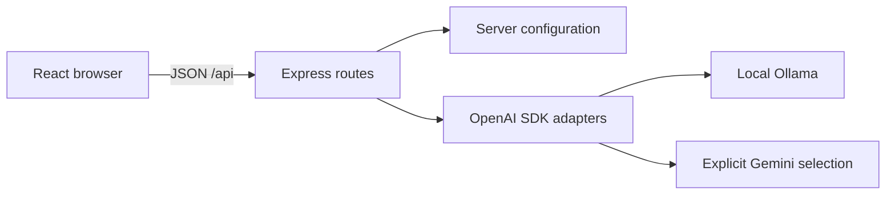

# Architecture

One npm project separates the browser (`src/client`), HTTP server (`src/server`), and runtime contracts (`src/shared`). Vite serves the browser during development; Express serves the built browser in production. Both bind to loopback.

The browser can send text and a provider choice. It cannot choose an upstream URL, supply a system message, or read a provider key. The server owns those decisions. Provider availability from `/api/config` only means configuration exists.

Stage 1 creates configuration and health routes. Later stages add chat transport, state, and cancellation, with diagrams updated alongside the code.
