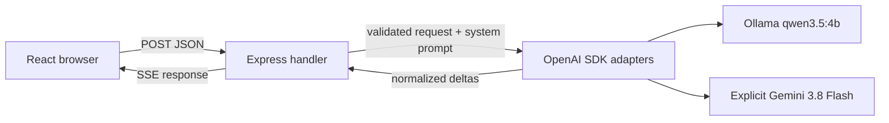
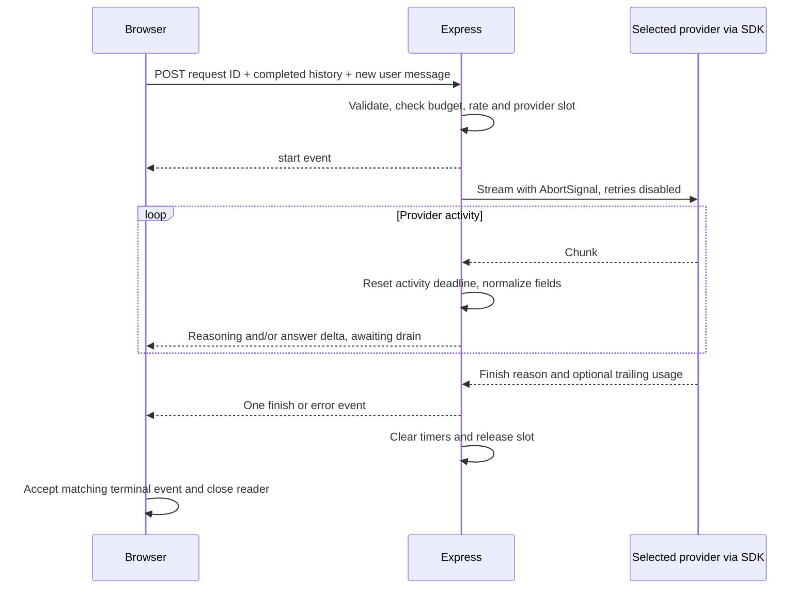
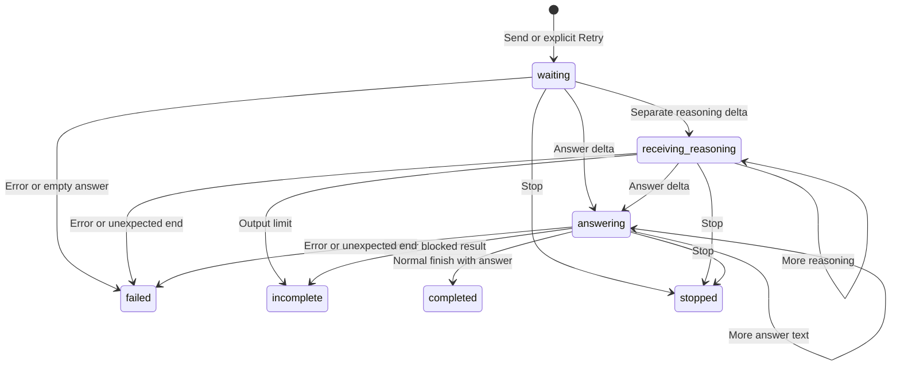

# Architecture

Express serves a personal chat application. Conversation state lives in React memory and is resubmitted explicitly on each turn. SQLite stores security counters and generation leases only. Protected mode authenticates one owner; multiple accounts, saved conversations, retrieval, tool execution, and automatic provider fallback remain outside this version.

## Component map and trust boundaries

| Boundary | Code | Responsibility |
|---|---|---|
| Browser application | [App.tsx](src/client/App.tsx) | Provider selection, composer, request identity, Stop, Retry, scroll position |
| Display state and history | [state.ts](src/client/state.ts) | Attempt provider/model and lifecycle states; only complete exchanges enter API history |
| Browser transport | [stream.ts](src/client/stream.ts) | Decode UTF-8, parse SSE, validate events, correlate request IDs, require a terminal result |
| Rendering | [Markdown.tsx](src/client/Markdown.tsx), [Turn.tsx](src/client/Turn.tsx) | Safe Markdown for answers and provider-supplied reasoning, code Copy, response status |
| Shared contracts | [protocol.ts](src/shared/protocol.ts) | Zod request, event, and public configuration schemas with inferred TypeScript types |
| HTTP entry | [app.ts](src/server/app.ts), [index.ts](src/server/index.ts) | Body-size limit, API routes, static files, loopback binding |
| Access policy | [access.ts](src/server/access.ts) | Host/Origin/Fetch Metadata validation, owner authentication, browser security headers, ingress checks before parsing |
| Security state | [security-state.ts](src/server/security-state.ts) | SQLite rate counters, daily provider allowances, shared generation leases and shutdown cleanup |
| Request lifecycle | [chat.ts](src/server/chat.ts), [sse.ts](src/server/sse.ts) | Validation, deadlines, active slots, rate guard, heartbeats, backpressure, cleanup |
| Provider boundary | [provider.ts](src/server/provider.ts), [normalize.ts](src/server/normalize.ts) | Server-only SDK clients and normalization of compatible provider chunks |
| Server policy | [config.ts](src/server/config.ts), [budget.ts](src/server/budget.ts), [prompt.ts](src/server/prompt.ts), [errors.ts](src/server/errors.ts) | Keys, models, budgets, tutor instruction, and safe errors |

The browser supplies user/assistant text, a provider enum, thinking preference, and request ID. It cannot supply a system role, key, or upstream URL. Zod rejects unknown request fields and invalid ordering. The server prepends its own tutor instruction. The key is never returned by `/api/config`, imported by client code, or written to request logs. Model-generated code is rendered as text; images are omitted and raw HTML is disabled.



## Request and cancellation paths



Stop can occur anywhere in that sequence, including before the first provider chunk:

```mermaid
sequenceDiagram
    participant B as Browser
    participant S as Express
    participant P as Provider SDK stream
    B->>B: Mark current attempt stopped
    B->>S: Abort fetch connection
    S->>P: Abort upstream signal on response close
    S->>S: Clear timers and release provider slot
    B->>B: Ignore late events; retain partial display
```

A deadline follows the upstream abort path but sends a safe terminal error when the browser is still connected. A response write that returns false pauses iteration until drain, disconnect, or abort. Heartbeats are comments every 15 seconds and never reset model activity timers.

## Response states



The actual status label is `receiving reasoning`. All terminal states reject later events. Retry creates a fresh attempt ID and uses the currently selected provider and its thinking preference. It replaces the latest unsuccessful attempt without adding another user turn. New chat aborts active work, clears memory and the draft, and resets the provider to Local and both thinking preferences to false. A blocked provider result is displayed as incomplete with a specific error message. Only `completed` exchanges become future context.

## Switching providers between turns

The selector describes the next request. It is disabled during waiting, reasoning, and answering; the change handler also checks the active-request ref and provider availability. Switching preserves the transcript, draft, and scroll position and makes no generation request. Local thinking and Gemini summaries retain separate preferences.

Each attempt snapshots its selected provider and configured model before fetching. The matching `start` event supplies the server-reported model. Response labels use that attempt metadata, so changing the selector cannot relabel past answers or failures before SSE begins. Request IDs and terminal states still reject late events after Stop or Retry.

The server has no conversation-level provider lock. Every request contains the shared completed user/assistant exchanges and its current question, independent of which provider wrote previous answers. Neither display-only reasoning nor unsuccessful answers are transmitted as history. Gemini selection shows a cloud-history notice; only Send or explicit Retry transmits the text. Credentials, models, and endpoints remain server-owned.

## Limits and deployment

Local context is 4,096 tokens, with at least 1,024 reserved for output and 256 as a safety margin. Each local request uses the remaining context after estimated input as its output limit, so short conversations have more room for reasoning and the answer. Input estimation counts UTF-8 bytes plus 16 per message, including the system prompt. This conservative application estimate is not an exact Qwen tokenizer. Gemini has a separate 24,000 estimated-input limit and 4,096 output-token cap. Neither history nor generated reasoning is silently summarized.

After switching from Gemini to Local, completed history may exceed Local's smaller input budget. The server returns HTTP 413 before upstream generation, and the client keeps the conversation visible. Switching back to Gemini and explicitly retrying reuses the question and completed history. There is no automatic provider fallback or trimming.

Development uses Vite's `/api` proxy. Production builds browser assets under `dist/client` and bundles the server under `dist/server`; Express serves both from the project root. Both development servers and production bind to loopback. Local access requires a loopback Host and connection. Protected access checks an exact configured origin/host and server-side owner credentials before parsing any JSON or serving assets. Foreign browser origins and same-site subresource requests without an allowed Origin are rejected before quota accounting. Forwarded headers never grant access or identify a caller.

SQLite under ignored `.local/` stores rate timestamps, daily token reservations, and active generation leases. No prompts, model output, credentials, or saved conversations enter it. Reservations happen atomically before an upstream request and survive restarts. Processes using the same local database share provider slots and budgets. Lease expiry recovers from a crashed process; a lease identifier prevents an older cleanup from deleting a newer generation. Clean shutdown defers database closure until owned leases have been released.

`npm start` requires protected access, HTTPS public-origin configuration, and persistent security state. The production HTTP server remains on loopback behind the TLS proxy and has bounded connection/request timeouts and connection counts. The built page uses a restrictive CSP without inline/eval script exceptions and framing is denied. This is a personal owner gate, not a multi-user account system. Firewall, TLS proxy, operating-system/IAM privileges, provider spending controls, and multi-host quota design require deployment work described in [SECURITY.md](SECURITY.md).
